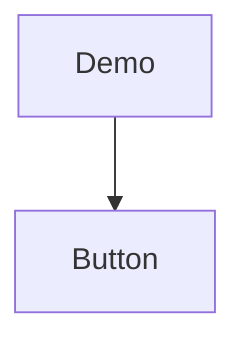

# Mermaid architecture docs

Diagram-as-code for CEV chunks: Mermaid is the **docs/chat** twin of the
same `visualGraph` / `lifecycleFlows` Remotion narrates. It does **not**
change FullVideo order.

Preferences: Q1–Q6 locked. Plan: store
`docs/mermaid-sequence-decision.md` + `docs/mermaid-architecture-master-plan.md`.

## Video vs docs

| Beat (Q1) | Video | Docs section |
|---|---|---|
| FileCard | Remotion card + TTS | Title / stack / fidelity |
| ComponentTreeClip | Remotion tree | `## Structure` → `flowchart TD` |
| LifecycleFlowClip | Remotion stepper | `## Lifecycle` → `sequenceDiagram` |
| ChunkView | Code + beats | `## Evidence` line refs |
| VisualBreakdownStill | End still + TTS | `## Interactive` + Mermaid fallback |

**Remotion wins video** (measured-beat highlight, brand chrome).  
**Mermaid wins docs** (diffable, pasteable, often clearer for ordered
lifecycle detail). Live Mermaid.js is **not** loaded in Remotion.

## Artifacts

| File | Role |
|---|---|
| `visuals/<stack>/<chunkId>/interactive.json` | `mermaid`, `mermaidLifecycle`, skip reasons |
| `visuals/<stack>/<chunkId>/architecture.md` | Honesty chrome + fenced diagrams |
| `src/visual/diagram_selection.py` | Selection plan (accuracy / surface / skip) |
| `src/visual/mermaid_export.py` | `export_mermaid`, `export_lifecycle_mermaid` |

Unavailable / empty / too_large → no fence (Q5). Assumed edges → `-.->`
or sequence `Note … assumed`. Never invent edges.

## Docs viewer

`render-app/docs-viewer-src` renders ` ```mermaid ` fences via Mermaid.js
after `marked`. Product narrative lives under `documentation/`; per-chunk
`architecture.md` is regenerated with visuals.

## Selection rules (short)

1. **Accuracy** — preserve assumed/honesty; if timing matters, Remotion.  
2. **Visual** — narrated mp4 → Remotion; static/shareable → Mermaid.  
3. **Detail** — trees → flowchart; ordered flows → sequenceDiagram.  

Per-stack diagram kinds and skip reasons:
[`20-mermaid-stack-matrix.md`](./20-mermaid-stack-matrix.md).

## Regenerate checked-in visuals

After exporter changes, backfill `mermaid` / `mermaidLifecycle` and
`architecture.md` from each `interactive.json` (no full re-extract):

```bash
python3 scripts/regen_mermaid_artifacts.py
```

Full pipeline attach (`build_visual_artifacts`) also writes these on
every extract/render run.

## CI parse gate

```bash
cd render-app && npm ci && npm run check:mermaid
```

Parses `visuals/**` Mermaid fields/fences plus product-doc fences via
Mermaid.js (`scripts/check-mermaid-syntax.mjs`).

## Example fence (viewer smoke)


