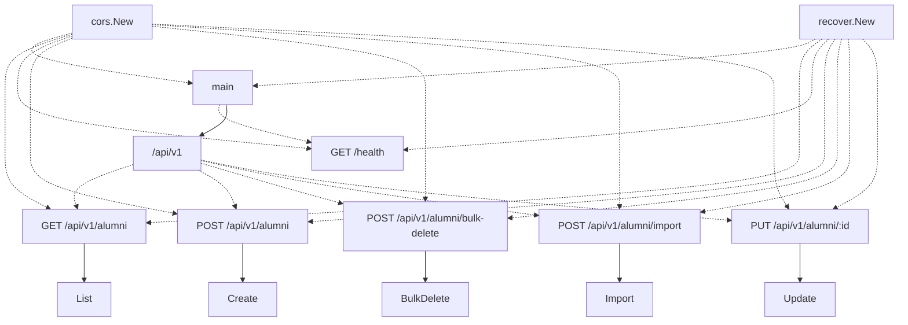

# Architecture — `api/cmd/server/main.go`

**Stack:** `go` · **Chunk:** `server-91d1514b` · **Fidelity:** `regex`

> Simplified Mermaid export of the same `visualGraph` / `lifecycleFlows` shown in Remotion. Layout is not pixel-identical to video.

> **Fidelity note:** regex extract — assumed edges may be dashed; empty → no fence.

> **Source of truth:** fences below are exported from this chunk's `visualGraph` / `lifecycleFlows` only — never invented for docs.

## Honesty

- Solid arrows (`-->`) = non-assumed edges from the extractor.
- Dashed arrows (`-.->`) or sequence `Note … assumed` = hedged facts.
- Unavailable / empty / too_large → no Mermaid fence (never invent).
- Docs/chat Mermaid is a twin of Remotion's graph — not a second topology.

## Availability

- componentTree: `partial`
- lifecycleFlow: `partial`
- interactiveBreakdown: `partial`

### Skip / honesty reasons

- `lifecycleFlow`: Hedged under regex fidelity.

## Structure

Mount / route / DI / module edges for this chunk (developer-scoped).

## Lifecycle

Ordered in-chunk control flow (handlers, middleware, API steps).

```mermaid
sequenceDiagram
  %% GET /api/v1/alumni
  participant trigger_flow_main_GET__api_v1_alumni as GET /api/v1/alumni
  participant flow_main_GET__api_v1_alumni_1_recover_New as recover.New
  trigger_flow_main_GET__api_v1_alumni->>flow_main_GET__api_v1_alumni_1_recover_New: middleware
  Note over flow_main_GET__api_v1_alumni_1_recover_New: assumed
  participant flow_main_GET__api_v1_alumni_2_cors_New as cors.New
  flow_main_GET__api_v1_alumni_1_recover_New->>flow_main_GET__api_v1_alumni_2_cors_New: middleware
  Note over flow_main_GET__api_v1_alumni_2_cors_New: assumed
  participant flow_main_GET__api_v1_alumni_3_List as List
  flow_main_GET__api_v1_alumni_2_cors_New->>flow_main_GET__api_v1_alumni_3_List: handler
  Note over flow_main_GET__api_v1_alumni_3_List: assumed
  participant flow_main_GET__api_v1_alumni_4_response_write as response write
  flow_main_GET__api_v1_alumni_3_List->>flow_main_GET__api_v1_alumni_4_response_write: response
  Note over flow_main_GET__api_v1_alumni_4_response_write: assumed
  %% POST /api/v1/alumni
  participant trigger_flow_main_POST__api_v1_alumni as POST /api/v1/alumni
  participant flow_main_POST__api_v1_alumni_1_recover_New as recover.New
  trigger_flow_main_POST__api_v1_alumni->>flow_main_POST__api_v1_alumni_1_recover_New: middleware
  Note over flow_main_POST__api_v1_alumni_1_recover_New: assumed
  participant flow_main_POST__api_v1_alumni_2_cors_New as cors.New
  flow_main_POST__api_v1_alumni_1_recover_New->>flow_main_POST__api_v1_alumni_2_cors_New: middleware
  Note over flow_main_POST__api_v1_alumni_2_cors_New: assumed
  participant flow_main_POST__api_v1_alumni_3_Create as Create
  flow_main_POST__api_v1_alumni_2_cors_New->>flow_main_POST__api_v1_alumni_3_Create: handler
  Note over flow_main_POST__api_v1_alumni_3_Create: assumed
  participant flow_main_POST__api_v1_alumni_4_response_write as response write
  flow_main_POST__api_v1_alumni_3_Create->>flow_main_POST__api_v1_alumni_4_response_write: response
  Note over flow_main_POST__api_v1_alumni_4_response_write: assumed
  %% POST /api/v1/alumni/bulk-delete
  participant trigger_flow_main_POST__api_v1_alumni_bulk_delete as POST /api/v1/alumni/bulk-delete
  participant flow_main_POST__api_v1_alumni_bulk_delete_1_recover_New as recover.New
  trigger_flow_main_POST__api_v1_alumni_bulk_delete->>flow_main_POST__api_v1_alumni_bulk_delete_1_recover_New: middleware
  Note over flow_main_POST__api_v1_alumni_bulk_delete_1_recover_New: assumed
  participant flow_main_POST__api_v1_alumni_bulk_delete_2_cors_New as cors.New
  flow_main_POST__api_v1_alumni_bulk_delete_1_recover_New->>flow_main_POST__api_v1_alumni_bulk_delete_2_cors_New: middleware
  Note over flow_main_POST__api_v1_alumni_bulk_delete_2_cors_New: assumed
  participant flow_main_POST__api_v1_alumni_bulk_delete_3_BulkDelete as BulkDelete
  flow_main_POST__api_v1_alumni_bulk_delete_2_cors_New->>flow_main_POST__api_v1_alumni_bulk_delete_3_BulkDelete: handler
  Note over flow_main_POST__api_v1_alumni_bulk_delete_3_BulkDelete: assumed
  participant flow_main_POST__api_v1_alumni_bulk_delete_4_response_write as response write
  flow_main_POST__api_v1_alumni_bulk_delete_3_BulkDelete->>flow_main_POST__api_v1_alumni_bulk_delete_4_response_write: response
  Note over flow_main_POST__api_v1_alumni_bulk_delete_4_response_write: assumed
  %% POST /api/v1/alumni/import
  participant trigger_flow_main_POST__api_v1_alumni_import as POST /api/v1/alumni/import
  participant flow_main_POST__api_v1_alumni_import_1_recover_New as recover.New
  trigger_flow_main_POST__api_v1_alumni_import->>flow_main_POST__api_v1_alumni_import_1_recover_New: middleware
  Note over flow_main_POST__api_v1_alumni_import_1_recover_New: assumed
  participant flow_main_POST__api_v1_alumni_import_2_cors_New as cors.New
  flow_main_POST__api_v1_alumni_import_1_recover_New->>flow_main_POST__api_v1_alumni_import_2_cors_New: middleware
  Note over flow_main_POST__api_v1_alumni_import_2_cors_New: assumed
  participant flow_main_POST__api_v1_alumni_import_3_Import as Import
  flow_main_POST__api_v1_alumni_import_2_cors_New->>flow_main_POST__api_v1_alumni_import_3_Import: handler
  Note over flow_main_POST__api_v1_alumni_import_3_Import: assumed
  participant flow_main_POST__api_v1_alumni_import_4_response_write as response write
  flow_main_POST__api_v1_alumni_import_3_Import->>flow_main_POST__api_v1_alumni_import_4_response_write: response
  Note over flow_main_POST__api_v1_alumni_import_4_response_write: assumed
```

## Evidence

- `BulkDelete` — `api/cmd/server/main.go:93`
- `Create` — `api/cmd/server/main.go:91`
- `Import` — `api/cmd/server/main.go:94`
- `List` — `api/cmd/server/main.go:90`
- `Update` — `api/cmd/server/main.go:92`
- `cors.New` — `api/cmd/server/main.go:80`
- `recover.New` — `api/cmd/server/main.go:77`
- `main` — `api/cmd/server/main.go:1`
- `GET /health` — `api/cmd/server/main.go:82`
- `recover.New` — lines `77–77`
- `cors.New` — lines `80–80`
- `List` — lines `90–90`
- `Create` — lines `91–91`
- `BulkDelete` — lines `93–93`
- `Import` — lines `94–94`
- `Update` — lines `92–92`

## Interactive

Primary exploration is the Cursor canvas over `interactive.json`. Mermaid above is the chat/docs fallback (≤40 nodes).

Docs diagram plan: `flowchart_td, sequence`.
