# Architecture — `src/features/admin/AlumniFormDialog.tsx`

**Stack:** `react` · **Chunk:** `admin-2a022424` · **Fidelity:** `regex`

> Simplified Mermaid export of the same `visualGraph` / `lifecycleFlows` shown in Remotion. Layout is not pixel-identical to video.

> **Fidelity note:** regex extract — assumed edges may be dashed; empty → no fence.

> **Source of truth:** fences below are exported from this chunk's `visualGraph` / `lifecycleFlows` only — never invented for docs.

## Honesty

- Solid arrows (`-->`) = non-assumed edges from the extractor.
- Dashed arrows (`-.->`) or sequence `Note … assumed` = hedged facts.
- Unavailable / empty / too_large → no Mermaid fence (never invent).
- Docs/chat Mermaid is a twin of Remotion's graph — not a second topology.

## Availability

- componentTree: `partial`
- lifecycleFlow: `partial`
- interactiveBreakdown: `partial`

### Skip / honesty reasons

- `componentTree`: No XProps interface found; prop layer incomplete.
- `lifecycleFlow`: Hook/render steps hedged under regex fidelity.

## Structure

Mount / route / DI / module edges for this chunk (developer-scoped).

```mermaid
flowchart TD
  component_Alert["Alert"]
  component_AlumniDraft["AlumniDraft"]
  component_AlumniFormDialog["AlumniFormDialog"]
  component_Box["Box"]
  component_Button["Button"]
  component_ClearIcon["ClearIcon"]
  component_Dialog["Dialog"]
  component_DialogActions["DialogActions"]
  component_DialogContent["DialogContent"]
  component_DialogTitle["DialogTitle"]
  component_Divider["Divider"]
  component_Grid["Grid"]
  component_IconButton["IconButton"]
  component_LinearProgress["LinearProgress"]
  component_Stack["Stack"]
  component_TextField["TextField"]
  component_Typography["Typography"]
  component_AlumniFormDialog --> component_Alert
  component_AlumniFormDialog --> component_AlumniDraft
  component_AlumniFormDialog --> component_Box
  component_AlumniFormDialog --> component_Box
  component_AlumniFormDialog --> component_Box
  component_AlumniFormDialog --> component_Button
  component_AlumniFormDialog --> component_Button
  component_AlumniFormDialog --> component_Button
  component_AlumniFormDialog --> component_ClearIcon
  component_AlumniFormDialog --> component_Dialog
  component_AlumniFormDialog --> component_DialogActions
  component_AlumniFormDialog --> component_DialogContent
  component_AlumniFormDialog --> component_DialogTitle
  component_AlumniFormDialog --> component_Divider
  component_AlumniFormDialog --> component_Grid
  component_AlumniFormDialog -.-> component_Grid
  component_AlumniFormDialog --> component_IconButton
  component_AlumniFormDialog --> component_LinearProgress
  component_AlumniFormDialog --> component_Stack
  component_AlumniFormDialog -.-> component_Stack
  component_AlumniFormDialog --> component_Stack
  component_AlumniFormDialog --> component_Stack
  component_AlumniFormDialog --> component_TextField
  component_AlumniFormDialog -.-> component_TextField
  component_AlumniFormDialog --> component_TextField
  component_AlumniFormDialog --> component_Typography
  component_AlumniFormDialog --> component_Typography
  component_AlumniFormDialog --> component_Typography
  component_AlumniFormDialog --> component_Typography
  component_AlumniFormDialog --> component_Typography
```

## Lifecycle

Ordered in-chunk control flow (handlers, middleware, API steps).

```mermaid
sequenceDiagram
  %% handleSave
  participant trigger_flow_AlumniFormDialog_handleSave as handleSave
  participant flow_AlumniFormDialog_handleSave_1_handleSave as handleSave
  trigger_flow_AlumniFormDialog_handleSave->>flow_AlumniFormDialog_handleSave_1_handleSave: event
  Note over flow_AlumniFormDialog_handleSave_1_handleSave: assumed
  participant flow_AlumniFormDialog_handleSave_2_useState as useState
  flow_AlumniFormDialog_handleSave_1_handleSave->>flow_AlumniFormDialog_handleSave_2_useState: state_update
  Note over flow_AlumniFormDialog_handleSave_2_useState: assumed
  participant flow_AlumniFormDialog_handleSave_3_useEffect as useEffect
  flow_AlumniFormDialog_handleSave_2_useState->>flow_AlumniFormDialog_handleSave_3_useEffect: other
  Note over flow_AlumniFormDialog_handleSave_3_useEffect: assumed
  participant flow_AlumniFormDialog_handleSave_4_re_render as re-render
  flow_AlumniFormDialog_handleSave_3_useEffect->>flow_AlumniFormDialog_handleSave_4_re_render: render
  Note over flow_AlumniFormDialog_handleSave_4_re_render: assumed
  %% inline_onBlur_L146
  participant trigger_flow_AlumniFormDialog_inline_onBlur_L146 as inline_onBlur_L146
  participant flow_AlumniFormDialog_inline_onBlur_L146_1_inline_onBlur_L146 as inline_onBlur_L146
  trigger_flow_AlumniFormDialog_inline_onBlur_L146->>flow_AlumniFormDialog_inline_onBlur_L146_1_inline_onBlur_L146: event
  Note over flow_AlumniFormDialog_inline_onBlur_L146_1_inline_onBlur_L146: assumed
  participant flow_AlumniFormDialog_inline_onBlur_L146_2_useState as useState
  flow_AlumniFormDialog_inline_onBlur_L146_1_inline_onBlur_L146->>flow_AlumniFormDialog_inline_onBlur_L146_2_useState: state_update
  Note over flow_AlumniFormDialog_inline_onBlur_L146_2_useState: assumed
  participant flow_AlumniFormDialog_inline_onBlur_L146_3_useEffect as useEffect
  flow_AlumniFormDialog_inline_onBlur_L146_2_useState->>flow_AlumniFormDialog_inline_onBlur_L146_3_useEffect: other
  Note over flow_AlumniFormDialog_inline_onBlur_L146_3_useEffect: assumed
  participant flow_AlumniFormDialog_inline_onBlur_L146_4_re_render as re-render
  flow_AlumniFormDialog_inline_onBlur_L146_3_useEffect->>flow_AlumniFormDialog_inline_onBlur_L146_4_re_render: render
  Note over flow_AlumniFormDialog_inline_onBlur_L146_4_re_render: assumed
  %% inline_onChange_L147
  participant trigger_flow_AlumniFormDialog_inline_onChange_L147 as inline_onChange_L147
  participant flow_AlumniFormDialog_inline_onChange_L147_1_inline_onChange_L147 as inline_onChange_L147
  trigger_flow_AlumniFormDialog_inline_onChange_L147->>flow_AlumniFormDialog_inline_onChange_L147_1_inline_onChange_L147: event
  Note over flow_AlumniFormDialog_inline_onChange_L147_1_inline_onChange_L147: assumed
  participant flow_AlumniFormDialog_inline_onChange_L147_2_useState as useState
  flow_AlumniFormDialog_inline_onChange_L147_1_inline_onChange_L147->>flow_AlumniFormDialog_inline_onChange_L147_2_useState: state_update
  Note over flow_AlumniFormDialog_inline_onChange_L147_2_useState: assumed
  participant flow_AlumniFormDialog_inline_onChange_L147_3_useEffect as useEffect
  flow_AlumniFormDialog_inline_onChange_L147_2_useState->>flow_AlumniFormDialog_inline_onChange_L147_3_useEffect: other
  Note over flow_AlumniFormDialog_inline_onChange_L147_3_useEffect: assumed
  participant flow_AlumniFormDialog_inline_onChange_L147_4_re_render as re-render
  flow_AlumniFormDialog_inline_onChange_L147_3_useEffect->>flow_AlumniFormDialog_inline_onChange_L147_4_re_render: render
  Note over flow_AlumniFormDialog_inline_onChange_L147_4_re_render: assumed
  %% inline_onChange_L180
  participant trigger_flow_AlumniFormDialog_inline_onChange_L180 as inline_onChange_L180
  participant flow_AlumniFormDialog_inline_onChange_L180_1_inline_onChange_L180 as inline_onChange_L180
  trigger_flow_AlumniFormDialog_inline_onChange_L180->>flow_AlumniFormDialog_inline_onChange_L180_1_inline_onChange_L180: event
  Note over flow_AlumniFormDialog_inline_onChange_L180_1_inline_onChange_L180: assumed
  participant flow_AlumniFormDialog_inline_onChange_L180_2_useState as useState
  flow_AlumniFormDialog_inline_onChange_L180_1_inline_onChange_L180->>flow_AlumniFormDialog_inline_onChange_L180_2_useState: state_update
  Note over flow_AlumniFormDialog_inline_onChange_L180_2_useState: assumed
  participant flow_AlumniFormDialog_inline_onChange_L180_3_useEffect as useEffect
  flow_AlumniFormDialog_inline_onChange_L180_2_useState->>flow_AlumniFormDialog_inline_onChange_L180_3_useEffect: other
  Note over flow_AlumniFormDialog_inline_onChange_L180_3_useEffect: assumed
  participant flow_AlumniFormDialog_inline_onChange_L180_4_re_render as re-render
  flow_AlumniFormDialog_inline_onChange_L180_3_useEffect->>flow_AlumniFormDialog_inline_onChange_L180_4_re_render: render
  Note over flow_AlumniFormDialog_inline_onChange_L180_4_re_render: assumed
```

## Evidence

- `Alert` — `src/features/admin/AlumniFormDialog.tsx:129`
- `AlumniDraft` — `src/features/admin/AlumniFormDialog.tsx:41`
- `AlumniFormDialog` — `src/features/admin/AlumniFormDialog.tsx:1`
- `Box` — `src/features/admin/AlumniFormDialog.tsx:106`
- `Button` — `src/features/admin/AlumniFormDialog.tsx:197`
- `ClearIcon` — `src/features/admin/AlumniFormDialog.tsx:192`
- `Dialog` — `src/features/admin/AlumniFormDialog.tsx:101`
- `DialogActions` — `src/features/admin/AlumniFormDialog.tsx:206`
- `DialogContent` — `src/features/admin/AlumniFormDialog.tsx:104`
- `DialogTitle` — `src/features/admin/AlumniFormDialog.tsx:102`
- `Divider` — `src/features/admin/AlumniFormDialog.tsx:162`
- `Grid` — `src/features/admin/AlumniFormDialog.tsx:132`
- `IconButton` — `src/features/admin/AlumniFormDialog.tsx:191`
- `LinearProgress` — `src/features/admin/AlumniFormDialog.tsx:113`
- `Stack` — `src/features/admin/AlumniFormDialog.tsx:105`
- `TextField` — `src/features/admin/AlumniFormDialog.tsx:137`
- `Typography` — `src/features/admin/AlumniFormDialog.tsx:108`
- `handleSave` — lines `85–98`
- `useState` — lines `45–45`
- `useEffect` — lines `47–47`
- `inline_onBlur_L146` — lines `146–146`
- `inline_onChange_L147` — lines `147–147`
- `inline_onChange_L180` — lines `180–180`
- `inline_onChange_L187` — lines `187–187`
- `inline_onClick_L191` — lines `191–191`
- `inline_onClick_L197` — lines `197–197`
- `inline_onClick_L207` — lines `207–207`
- `inline_onClose_L101` — lines `101–101`

## Interactive

Primary exploration is the Cursor canvas over `interactive.json`. Mermaid above is the chat/docs fallback (≤40 nodes).

Docs diagram plan: `flowchart_td, sequence`.
