# Architecture — `src/features/admin/ExcelImportDialog.tsx`

**Stack:** `react` · **Chunk:** `admin-689d5aa1` · **Fidelity:** `regex`

> Simplified Mermaid export of the same `visualGraph` / `lifecycleFlows` shown in Remotion. Layout is not pixel-identical to video.

> **Fidelity note:** regex extract — assumed edges may be dashed; empty → no fence.

## Honesty

- Solid arrows (`-->`) = non-assumed edges from the extractor.
- Dashed arrows (`-.->`) or sequence `Note … assumed` = hedged facts.
- Unavailable / empty / too_large → no Mermaid fence (never invent).

## Availability

- componentTree: `partial`
- lifecycleFlow: `partial`
- interactiveBreakdown: `partial`

### Skip / honesty reasons

- `componentTree`: No XProps interface found; prop layer incomplete.
- `lifecycleFlow`: Hook/render steps hedged under regex fidelity.

## Structure

Mount / route / DI / module edges for this chunk (developer-scoped).

```mermaid
flowchart TD
  component_Alert["Alert"]
  component_Box["Box"]
  component_Button["Button"]
  component_Chip["Chip"]
  component_Dialog["Dialog"]
  component_DialogActions["DialogActions"]
  component_DialogContent["DialogContent"]
  component_DialogTitle["DialogTitle"]
  component_ExcelImportDialog["ExcelImportDialog"]
  component_HTMLInputElement["HTMLInputElement"]
  component_Link["Link"]
  component_Stack["Stack"]
  component_Table["Table"]
  component_TableBody["TableBody"]
  component_TableCell["TableCell"]
  component_TableHead["TableHead"]
  component_TableRow["TableRow"]
  component_Typography["Typography"]
  component_ExcelImportDialog --> component_Alert
  component_ExcelImportDialog --> component_Alert
  component_ExcelImportDialog --> component_Box
  component_ExcelImportDialog --> component_Box
  component_ExcelImportDialog --> component_Box
  component_ExcelImportDialog --> component_Button
  component_ExcelImportDialog --> component_Button
  component_ExcelImportDialog --> component_Button
  component_ExcelImportDialog --> component_Chip
  component_ExcelImportDialog --> component_Chip
  component_ExcelImportDialog --> component_Dialog
  component_ExcelImportDialog --> component_DialogActions
  component_ExcelImportDialog --> component_DialogContent
  component_ExcelImportDialog --> component_DialogTitle
  component_ExcelImportDialog --> component_HTMLInputElement
  component_ExcelImportDialog --> component_Link
  component_ExcelImportDialog --> component_Stack
  component_ExcelImportDialog --> component_Stack
  component_ExcelImportDialog --> component_Stack
  component_ExcelImportDialog --> component_Table
  component_ExcelImportDialog --> component_TableBody
  component_ExcelImportDialog --> component_TableCell
  component_ExcelImportDialog --> component_TableCell
  component_ExcelImportDialog --> component_TableCell
  component_ExcelImportDialog -.-> component_TableCell
  component_ExcelImportDialog --> component_TableCell
  component_ExcelImportDialog --> component_TableCell
  component_ExcelImportDialog --> component_TableHead
  component_ExcelImportDialog --> component_TableRow
  component_ExcelImportDialog -.-> component_TableRow
  component_ExcelImportDialog --> component_Typography
  component_ExcelImportDialog --> component_Typography
```

## Lifecycle

Ordered in-chunk control flow (handlers, middleware, API steps).

```mermaid
sequenceDiagram
  %% handleFile
  participant trigger_flow_ExcelImportDialog_handleFile as handleFile
  participant flow_ExcelImportDialog_handleFile_1_handleFile as handleFile
  trigger_flow_ExcelImportDialog_handleFile->>flow_ExcelImportDialog_handleFile_1_handleFile: event
  Note over flow_ExcelImportDialog_handleFile_1_handleFile: assumed
  participant flow_ExcelImportDialog_handleFile_2_useState as useState
  flow_ExcelImportDialog_handleFile_1_handleFile->>flow_ExcelImportDialog_handleFile_2_useState: state_update
  Note over flow_ExcelImportDialog_handleFile_2_useState: assumed
  participant flow_ExcelImportDialog_handleFile_3_re_render as re-render
  flow_ExcelImportDialog_handleFile_2_useState->>flow_ExcelImportDialog_handleFile_3_re_render: render
  Note over flow_ExcelImportDialog_handleFile_3_re_render: assumed
  %% inline_onChange_L116
  participant trigger_flow_ExcelImportDialog_inline_onChange_L116 as inline_onChange_L116
  participant flow_ExcelImportDialog_inline_onChange_L116_1_inline_onChange_L116 as inline_onChange_L116
  trigger_flow_ExcelImportDialog_inline_onChange_L116->>flow_ExcelImportDialog_inline_onChange_L116_1_inline_onChange_L116: event
  Note over flow_ExcelImportDialog_inline_onChange_L116_1_inline_onChange_L116: assumed
  participant flow_ExcelImportDialog_inline_onChange_L116_2_useState as useState
  flow_ExcelImportDialog_inline_onChange_L116_1_inline_onChange_L116->>flow_ExcelImportDialog_inline_onChange_L116_2_useState: state_update
  Note over flow_ExcelImportDialog_inline_onChange_L116_2_useState: assumed
  participant flow_ExcelImportDialog_inline_onChange_L116_3_re_render as re-render
  flow_ExcelImportDialog_inline_onChange_L116_2_useState->>flow_ExcelImportDialog_inline_onChange_L116_3_re_render: render
  Note over flow_ExcelImportDialog_inline_onChange_L116_3_re_render: assumed
  %% inline_onClick_L103
  participant trigger_flow_ExcelImportDialog_inline_onClick_L103 as inline_onClick_L103
  participant flow_ExcelImportDialog_inline_onClick_L103_1_inline_onClick_L103 as inline_onClick_L103
  trigger_flow_ExcelImportDialog_inline_onClick_L103->>flow_ExcelImportDialog_inline_onClick_L103_1_inline_onClick_L103: event
  Note over flow_ExcelImportDialog_inline_onClick_L103_1_inline_onClick_L103: assumed
  participant flow_ExcelImportDialog_inline_onClick_L103_2_useState as useState
  flow_ExcelImportDialog_inline_onClick_L103_1_inline_onClick_L103->>flow_ExcelImportDialog_inline_onClick_L103_2_useState: state_update
  Note over flow_ExcelImportDialog_inline_onClick_L103_2_useState: assumed
  participant flow_ExcelImportDialog_inline_onClick_L103_3_re_render as re-render
  flow_ExcelImportDialog_inline_onClick_L103_2_useState->>flow_ExcelImportDialog_inline_onClick_L103_3_re_render: render
  Note over flow_ExcelImportDialog_inline_onClick_L103_3_re_render: assumed
  %% inline_onClick_L124
  participant trigger_flow_ExcelImportDialog_inline_onClick_L124 as inline_onClick_L124
  participant flow_ExcelImportDialog_inline_onClick_L124_1_inline_onClick_L124 as inline_onClick_L124
  trigger_flow_ExcelImportDialog_inline_onClick_L124->>flow_ExcelImportDialog_inline_onClick_L124_1_inline_onClick_L124: event
  Note over flow_ExcelImportDialog_inline_onClick_L124_1_inline_onClick_L124: assumed
  participant flow_ExcelImportDialog_inline_onClick_L124_2_useState as useState
  flow_ExcelImportDialog_inline_onClick_L124_1_inline_onClick_L124->>flow_ExcelImportDialog_inline_onClick_L124_2_useState: state_update
  Note over flow_ExcelImportDialog_inline_onClick_L124_2_useState: assumed
  participant flow_ExcelImportDialog_inline_onClick_L124_3_re_render as re-render
  flow_ExcelImportDialog_inline_onClick_L124_2_useState->>flow_ExcelImportDialog_inline_onClick_L124_3_re_render: render
  Note over flow_ExcelImportDialog_inline_onClick_L124_3_re_render: assumed
```

## Evidence

- `Alert` — `src/features/admin/ExcelImportDialog.tsx:100`
- `Box` — `src/features/admin/ExcelImportDialog.tsx:110`
- `Button` — `src/features/admin/ExcelImportDialog.tsx:121`
- `Chip` — `src/features/admin/ExcelImportDialog.tsx:140`
- `Dialog` — `src/features/admin/ExcelImportDialog.tsx:95`
- `DialogActions` — `src/features/admin/ExcelImportDialog.tsx:178`
- `DialogContent` — `src/features/admin/ExcelImportDialog.tsx:98`
- `DialogTitle` — `src/features/admin/ExcelImportDialog.tsx:96`
- `ExcelImportDialog` — `src/features/admin/ExcelImportDialog.tsx:1`
- `HTMLInputElement` — `src/features/admin/ExcelImportDialog.tsx:35`
- `Link` — `src/features/admin/ExcelImportDialog.tsx:103`
- `Stack` — `src/features/admin/ExcelImportDialog.tsx:99`
- `Table` — `src/features/admin/ExcelImportDialog.tsx:153`
- `TableBody` — `src/features/admin/ExcelImportDialog.tsx:161`
- `TableCell` — `src/features/admin/ExcelImportDialog.tsx:156`
- `TableHead` — `src/features/admin/ExcelImportDialog.tsx:154`
- `TableRow` — `src/features/admin/ExcelImportDialog.tsx:155`
- `Typography` — `src/features/admin/ExcelImportDialog.tsx:130`
- `handleFile` — lines `53–82`
- `useState` — lines `36–36`
- `inline_onChange_L116` — lines `116–116`
- `inline_onClick_L103` — lines `103–103`
- `inline_onClick_L124` — lines `124–124`
- `inline_onClick_L179` — lines `179–179`
- `inline_onClick_L183` — lines `183–183`
- `inline_onClose_L95` — lines `95–95`

## Interactive

Primary exploration is the Cursor canvas over `interactive.json`. Mermaid above is the chat/docs fallback (≤40 nodes).

Docs diagram plan: `flowchart_td, sequence`.
