# Architecture — `src/features/admin/AlumniAdminGrid.tsx`

**Stack:** `react` · **Chunk:** `admin-ce73d200` · **Fidelity:** `regex`

> Simplified Mermaid export of the same `visualGraph` / `lifecycleFlows` shown in Remotion. Layout is not pixel-identical to video.

> **Fidelity note:** regex extract — assumed edges may be dashed; empty → no fence.

> **Source of truth:** fences below are exported from this chunk's `visualGraph` / `lifecycleFlows` only — never invented for docs.

## Honesty

- Solid arrows (`-->`) = non-assumed edges from the extractor.
- Dashed arrows (`-.->`) or sequence `Note … assumed` = hedged facts.
- Unavailable / empty / too_large → no Mermaid fence (never invent).
- Docs/chat Mermaid is a twin of Remotion's graph — not a second topology.

## Availability

- componentTree: `partial`
- lifecycleFlow: `partial`
- interactiveBreakdown: `partial`

### Skip / honesty reasons

- `componentTree`: No XProps interface found; prop layer incomplete.
- `lifecycleFlow`: Hook/render steps hedged under regex fidelity.

## Structure

Mount / route / DI / module edges for this chunk (developer-scoped).

```mermaid
flowchart TD
  component_AlumniAdminGrid["AlumniAdminGrid"]
  component_AlumniFormDialog["AlumniFormDialog"]
  component_AlumniRow["AlumniRow"]
  component_Box["Box"]
  component_Button["Button"]
  component_Chip["Chip"]
  component_Dialog["Dialog"]
  component_DialogActions["DialogActions"]
  component_DialogContent["DialogContent"]
  component_DialogContentText["DialogContentText"]
  component_DialogTitle["DialogTitle"]
  component_ExcelImportDialog["ExcelImportDialog"]
  component_LinearProgress["LinearProgress"]
  component_MenuItem["MenuItem"]
  component_Snackbar["Snackbar"]
  component_Stack["Stack"]
  component_TextField["TextField"]
  component_Tooltip["Tooltip"]
  component_Typography["Typography"]
  component_AlumniAdminGrid --> component_AlumniFormDialog
  component_AlumniAdminGrid --> component_AlumniRow
  component_AlumniAdminGrid --> component_AlumniRow
  component_AlumniAdminGrid --> component_AlumniRow
  component_AlumniAdminGrid --> component_AlumniRow
  component_AlumniAdminGrid --> component_Box
  component_AlumniAdminGrid --> component_Box
  component_AlumniAdminGrid --> component_Button
  component_AlumniAdminGrid --> component_Button
  component_AlumniAdminGrid --> component_Button
  component_AlumniAdminGrid --> component_Button
  component_AlumniAdminGrid --> component_Button
  component_AlumniAdminGrid --> component_Button
  component_AlumniAdminGrid --> component_Button
  component_AlumniAdminGrid --> component_Button
  component_AlumniAdminGrid --> component_Chip
  component_AlumniAdminGrid --> component_Dialog
  component_AlumniAdminGrid --> component_DialogActions
  component_AlumniAdminGrid --> component_DialogContent
  component_AlumniAdminGrid --> component_DialogContentText
  component_AlumniAdminGrid --> component_DialogTitle
  component_AlumniAdminGrid --> component_ExcelImportDialog
  component_AlumniAdminGrid --> component_LinearProgress
  component_AlumniAdminGrid --> component_MenuItem
  component_AlumniAdminGrid -.-> component_MenuItem
  component_AlumniAdminGrid --> component_Snackbar
  component_AlumniAdminGrid --> component_Stack
  component_AlumniAdminGrid --> component_Stack
  component_AlumniAdminGrid --> component_Stack
  component_AlumniAdminGrid --> component_TextField
  component_AlumniAdminGrid --> component_TextField
  component_AlumniAdminGrid --> component_Tooltip
  component_AlumniAdminGrid --> component_Typography
```

## Lifecycle

Ordered in-chunk control flow (handlers, middleware, API steps).

```mermaid
sequenceDiagram
  %% inline_onChange_L160
  participant trigger_flow_AlumniAdminGrid_inline_onChange_L160 as inline_onChange_L160
  participant flow_AlumniAdminGrid_inline_onChange_L160_1_inline_onChange_L160 as inline_onChange_L160
  trigger_flow_AlumniAdminGrid_inline_onChange_L160->>flow_AlumniAdminGrid_inline_onChange_L160_1_inline_onChange_L160: event
  Note over flow_AlumniAdminGrid_inline_onChange_L160_1_inline_onChange_L160: assumed
  participant flow_AlumniAdminGrid_inline_onChange_L160_2_useQueryClient as useQueryClient
  flow_AlumniAdminGrid_inline_onChange_L160_1_inline_onChange_L160->>flow_AlumniAdminGrid_inline_onChange_L160_2_useQueryClient: other
  Note over flow_AlumniAdminGrid_inline_onChange_L160_2_useQueryClient: assumed
  participant flow_AlumniAdminGrid_inline_onChange_L160_3_useState as useState
  flow_AlumniAdminGrid_inline_onChange_L160_2_useQueryClient->>flow_AlumniAdminGrid_inline_onChange_L160_3_useState: state_update
  Note over flow_AlumniAdminGrid_inline_onChange_L160_3_useState: assumed
  participant flow_AlumniAdminGrid_inline_onChange_L160_4_useState as useState
  flow_AlumniAdminGrid_inline_onChange_L160_3_useState->>flow_AlumniAdminGrid_inline_onChange_L160_4_useState: state_update
  Note over flow_AlumniAdminGrid_inline_onChange_L160_4_useState: assumed
  participant flow_AlumniAdminGrid_inline_onChange_L160_5_useState as useState
  flow_AlumniAdminGrid_inline_onChange_L160_4_useState->>flow_AlumniAdminGrid_inline_onChange_L160_5_useState: state_update
  Note over flow_AlumniAdminGrid_inline_onChange_L160_5_useState: assumed
  participant flow_AlumniAdminGrid_inline_onChange_L160_6_useState as useState
  flow_AlumniAdminGrid_inline_onChange_L160_5_useState->>flow_AlumniAdminGrid_inline_onChange_L160_6_useState: state_update
  Note over flow_AlumniAdminGrid_inline_onChange_L160_6_useState: assumed
  participant flow_AlumniAdminGrid_inline_onChange_L160_7_useState as useState
  flow_AlumniAdminGrid_inline_onChange_L160_6_useState->>flow_AlumniAdminGrid_inline_onChange_L160_7_useState: state_update
  Note over flow_AlumniAdminGrid_inline_onChange_L160_7_useState: assumed
  participant flow_AlumniAdminGrid_inline_onChange_L160_8_useState as useState
  flow_AlumniAdminGrid_inline_onChange_L160_7_useState->>flow_AlumniAdminGrid_inline_onChange_L160_8_useState: state_update
  Note over flow_AlumniAdminGrid_inline_onChange_L160_8_useState: assumed
  participant flow_AlumniAdminGrid_inline_onChange_L160_9_useState as useState
  flow_AlumniAdminGrid_inline_onChange_L160_8_useState->>flow_AlumniAdminGrid_inline_onChange_L160_9_useState: state_update
  Note over flow_AlumniAdminGrid_inline_onChange_L160_9_useState: assumed
  participant flow_AlumniAdminGrid_inline_onChange_L160_10_useDeferredValue as useDeferredValue
  flow_AlumniAdminGrid_inline_onChange_L160_9_useState->>flow_AlumniAdminGrid_inline_onChange_L160_10_useDeferredValue: other
  Note over flow_AlumniAdminGrid_inline_onChange_L160_10_useDeferredValue: assumed
  participant flow_AlumniAdminGrid_inline_onChange_L160_11_useQuery as useQuery
  flow_AlumniAdminGrid_inline_onChange_L160_10_useDeferredValue->>flow_AlumniAdminGrid_inline_onChange_L160_11_useQuery: other
  Note over flow_AlumniAdminGrid_inline_onChange_L160_11_useQuery: assumed
  participant flow_AlumniAdminGrid_inline_onChange_L160_12_useMutation as useMutation
  flow_AlumniAdminGrid_inline_onChange_L160_11_useQuery->>flow_AlumniAdminGrid_inline_onChange_L160_12_useMutation: other
  Note over flow_AlumniAdminGrid_inline_onChange_L160_12_useMutation: assumed
  participant flow_AlumniAdminGrid_inline_onChange_L160_13_useMutation as useMutation
  flow_AlumniAdminGrid_inline_onChange_L160_12_useMutation->>flow_AlumniAdminGrid_inline_onChange_L160_13_useMutation: other
  Note over flow_AlumniAdminGrid_inline_onChange_L160_13_useMutation: assumed
  participant flow_AlumniAdminGrid_inline_onChange_L160_14_useMutation as useMutation
  flow_AlumniAdminGrid_inline_onChange_L160_13_useMutation->>flow_AlumniAdminGrid_inline_onChange_L160_14_useMutation: other
  Note over flow_AlumniAdminGrid_inline_onChange_L160_14_useMutation: assumed
  participant flow_AlumniAdminGrid_inline_onChange_L160_15_re_render as re-render
  flow_AlumniAdminGrid_inline_onChange_L160_14_useMutation->>flow_AlumniAdminGrid_inline_onChange_L160_15_re_render: render
  Note over flow_AlumniAdminGrid_inline_onChange_L160_15_re_render: assumed
  %% inline_onChange_L168
  participant trigger_flow_AlumniAdminGrid_inline_onChange_L168 as inline_onChange_L168
  participant flow_AlumniAdminGrid_inline_onChange_L168_1_inline_onChange_L168 as inline_onChange_L168
  trigger_flow_AlumniAdminGrid_inline_onChange_L168->>flow_AlumniAdminGrid_inline_onChange_L168_1_inline_onChange_L168: event
  Note over flow_AlumniAdminGrid_inline_onChange_L168_1_inline_onChange_L168: assumed
  participant flow_AlumniAdminGrid_inline_onChange_L168_2_useQueryClient as useQueryClient
  flow_AlumniAdminGrid_inline_onChange_L168_1_inline_onChange_L168->>flow_AlumniAdminGrid_inline_onChange_L168_2_useQueryClient: other
  Note over flow_AlumniAdminGrid_inline_onChange_L168_2_useQueryClient: assumed
  participant flow_AlumniAdminGrid_inline_onChange_L168_3_useState as useState
  flow_AlumniAdminGrid_inline_onChange_L168_2_useQueryClient->>flow_AlumniAdminGrid_inline_onChange_L168_3_useState: state_update
  Note over flow_AlumniAdminGrid_inline_onChange_L168_3_useState: assumed
  participant flow_AlumniAdminGrid_inline_onChange_L168_4_useState as useState
  flow_AlumniAdminGrid_inline_onChange_L168_3_useState->>flow_AlumniAdminGrid_inline_onChange_L168_4_useState: state_update
  Note over flow_AlumniAdminGrid_inline_onChange_L168_4_useState: assumed
  participant flow_AlumniAdminGrid_inline_onChange_L168_5_useState as useState
  flow_AlumniAdminGrid_inline_onChange_L168_4_useState->>flow_AlumniAdminGrid_inline_onChange_L168_5_useState: state_update
  Note over flow_AlumniAdminGrid_inline_onChange_L168_5_useState: assumed
  participant flow_AlumniAdminGrid_inline_onChange_L168_6_useState as useState
  flow_AlumniAdminGrid_inline_onChange_L168_5_useState->>flow_AlumniAdminGrid_inline_onChange_L168_6_useState: state_update
  Note over flow_AlumniAdminGrid_inline_onChange_L168_6_useState: assumed
  participant flow_AlumniAdminGrid_inline_onChange_L168_7_useState as useState
  flow_AlumniAdminGrid_inline_onChange_L168_6_useState->>flow_AlumniAdminGrid_inline_onChange_L168_7_useState: state_update
  Note over flow_AlumniAdminGrid_inline_onChange_L168_7_useState: assumed
  participant flow_AlumniAdminGrid_inline_onChange_L168_8_useState as useState
  flow_AlumniAdminGrid_inline_onChange_L168_7_useState->>flow_AlumniAdminGrid_inline_onChange_L168_8_useState: state_update
  Note over flow_AlumniAdminGrid_inline_onChange_L168_8_useState: assumed
  participant flow_AlumniAdminGrid_inline_onChange_L168_9_useState as useState
  flow_AlumniAdminGrid_inline_onChange_L168_8_useState->>flow_AlumniAdminGrid_inline_onChange_L168_9_useState: state_update
  Note over flow_AlumniAdminGrid_inline_onChange_L168_9_useState: assumed
```

## Evidence

- `AlumniAdminGrid` — `src/features/admin/AlumniAdminGrid.tsx:1`
- `AlumniFormDialog` — `src/features/admin/AlumniAdminGrid.tsx:244`
- `AlumniRow` — `src/features/admin/AlumniAdminGrid.tsx:48`
- `Box` — `src/features/admin/AlumniAdminGrid.tsx:175`
- `Button` — `src/features/admin/AlumniAdminGrid.tsx:177`
- `Chip` — `src/features/admin/AlumniAdminGrid.tsx:124`
- `Dialog` — `src/features/admin/AlumniAdminGrid.tsx:259`
- `DialogActions` — `src/features/admin/AlumniAdminGrid.tsx:268`
- `DialogContent` — `src/features/admin/AlumniAdminGrid.tsx:261`
- `DialogContentText` — `src/features/admin/AlumniAdminGrid.tsx:262`
- `DialogTitle` — `src/features/admin/AlumniAdminGrid.tsx:260`
- `ExcelImportDialog` — `src/features/admin/AlumniAdminGrid.tsx:252`
- `LinearProgress` — `src/features/admin/AlumniAdminGrid.tsx:209`
- `MenuItem` — `src/features/admin/AlumniAdminGrid.tsx:171`
- `Snackbar` — `src/features/admin/AlumniAdminGrid.tsx:281`
- `Stack` — `src/features/admin/AlumniAdminGrid.tsx:154`
- `TextField` — `src/features/admin/AlumniAdminGrid.tsx:156`
- `Tooltip` — `src/features/admin/AlumniAdminGrid.tsx:184`
- `Typography` — `src/features/admin/AlumniAdminGrid.tsx:232`
- `inline_onChange_L160` — lines `160–160`
- `useQueryClient` — lines `40–40`
- `useState` — lines `42–42`
- `useState` — lines `43–43`
- `useState` — lines `44–44`
- `useState` — lines `47–47`
- `useState` — lines `49–49`
- `useState` — lines `50–50`
- `useState` — lines `51–51`
- `useDeferredValue` — lines `55–55`
- `useQuery` — lines `57–57`
- `useMutation` — lines `74–74`
- `useMutation` — lines `83–83`
- `useMutation` — lines `91–91`
- `inline_onChange_L168` — lines `168–168`
- `inline_onClick_L180` — lines `180–180`
- `inline_onClick_L190` — lines `190–190`
- `inline_onClick_L196` — lines `196–196`
- `inline_onClick_L203` — lines `203–203`
- `inline_onClick_L229` — lines `229–229`
- `inline_onClick_L238` — lines `238–238`

## Interactive

Primary exploration is the Cursor canvas over `interactive.json`. Mermaid above is the chat/docs fallback (≤40 nodes).

Docs diagram plan: `flowchart_td, sequence`.
