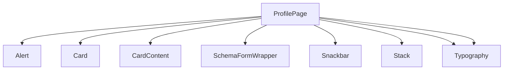
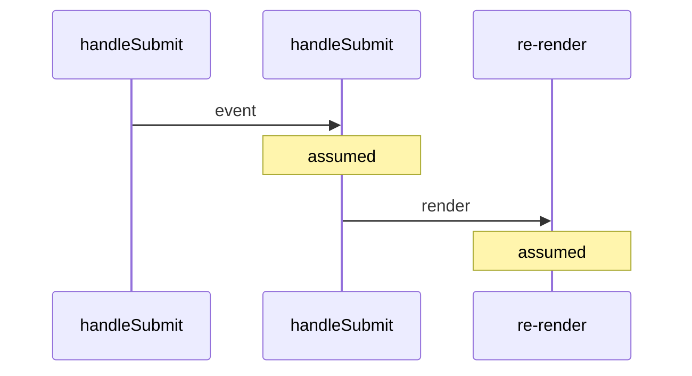

# Architecture — `src/features/alumni/ProfilePage.tsx`

**Stack:** `react` · **Chunk:** `alumni-06f407dc` · **Fidelity:** `regex`

> Simplified Mermaid export of the same `visualGraph` / `lifecycleFlows` shown in Remotion. Layout is not pixel-identical to video.

## Availability

- componentTree: `partial`
- lifecycleFlow: `partial`
- interactiveBreakdown: `partial`

### Skip / honesty reasons

- `componentTree`: No XProps interface found; prop layer incomplete.
- `lifecycleFlow`: Hook/render steps hedged under regex fidelity.

## Structure

Mount / route / DI / module edges for this chunk (developer-scoped).

## Lifecycle

Ordered in-chunk control flow (handlers, middleware, API steps).

## Evidence

- `Alert` — `src/features/alumni/ProfilePage.tsx:50`
- `Card` — `src/features/alumni/ProfilePage.tsx:52`
- `CardContent` — `src/features/alumni/ProfilePage.tsx:53`
- `ProfilePage` — `src/features/alumni/ProfilePage.tsx:1`
- `SchemaFormWrapper` — `src/features/alumni/ProfilePage.tsx:54`
- `Snackbar` — `src/features/alumni/ProfilePage.tsx:62`
- `Stack` — `src/features/alumni/ProfilePage.tsx:41`
- `Typography` — `src/features/alumni/ProfilePage.tsx:43`
- `handleSubmit` — lines `21–31`

## Interactive

Primary exploration is the Cursor canvas over `interactive.json`. Mermaid above is the chat/docs fallback (≤40 nodes).

Docs diagram plan: `flowchart_td, sequence`.
