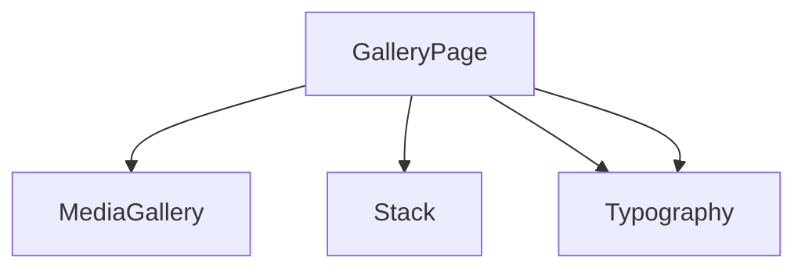

# Architecture — `src/features/media/GalleryPage.tsx`

**Stack:** `react` · **Chunk:** `media-7d6df8b7` · **Fidelity:** `regex`

> Simplified Mermaid export of the same `visualGraph` / `lifecycleFlows` shown in Remotion. Layout is not pixel-identical to video.

## Availability

- componentTree: `partial`
- lifecycleFlow: `unavailable`
- interactiveBreakdown: `partial`

### Skip / honesty reasons

- `componentTree`: No XProps interface found; prop layer incomplete.
- `lifecycleFlow`: no_lifecycle_triggers_extracted

## Structure

Mount / route / DI / module edges for this chunk (developer-scoped).

## Lifecycle

_No lifecycle diagram (`empty`)._

## Evidence

- `GalleryPage` — `src/features/media/GalleryPage.tsx:1`
- `MediaGallery` — `src/features/media/GalleryPage.tsx:23`
- `Stack` — `src/features/media/GalleryPage.tsx:16`
- `Typography` — `src/features/media/GalleryPage.tsx:18`

## Interactive

Primary exploration is the Cursor canvas over `interactive.json`. Mermaid above is the chat/docs fallback (≤40 nodes).

Docs diagram plan: `flowchart_td`.
