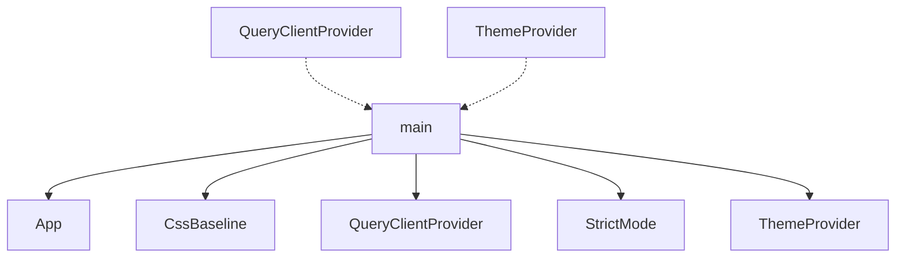

# Architecture — `src/main.tsx`

**Stack:** `react` · **Chunk:** `src-acd3f3ae` · **Fidelity:** `regex`

> Simplified Mermaid export of the same `visualGraph` / `lifecycleFlows` shown in Remotion. Layout is not pixel-identical to video.

> **Fidelity note:** regex extract — assumed edges may be dashed; empty → no fence.

> **Source of truth:** fences below are exported from this chunk's `visualGraph` / `lifecycleFlows` only — never invented for docs.

## Honesty

- Solid arrows (`-->`) = non-assumed edges from the extractor.
- Dashed arrows (`-.->`) or sequence `Note … assumed` = hedged facts.
- Unavailable / empty / too_large → no Mermaid fence (never invent).
- Docs/chat Mermaid is a twin of Remotion's graph — not a second topology.

## Availability

- componentTree: `partial`
- lifecycleFlow: `unavailable`
- interactiveBreakdown: `partial`

### Skip / honesty reasons

- `componentTree`: No XProps interface found; prop layer incomplete.
- `lifecycleFlow`: no_lifecycle_triggers_extracted

## Structure

Mount / route / DI / module edges for this chunk (developer-scoped).

## Lifecycle

_No lifecycle diagram (`empty`)._

## Evidence

- `App` — `src/main.tsx:36`
- `CssBaseline` — `src/main.tsx:35`
- `QueryClientProvider` — `src/main.tsx:33`
- `StrictMode` — `src/main.tsx:32`
- `ThemeProvider` — `src/main.tsx:34`
- `main` — `src/main.tsx:1`

## Interactive

Primary exploration is the Cursor canvas over `interactive.json`. Mermaid above is the chat/docs fallback (≤40 nodes).

Docs diagram plan: `flowchart_td`.
